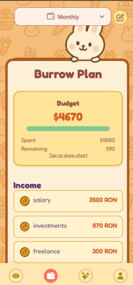
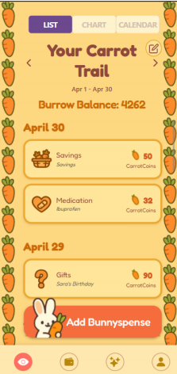
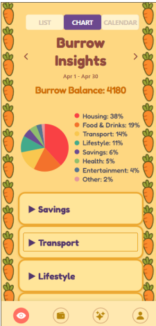
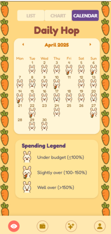
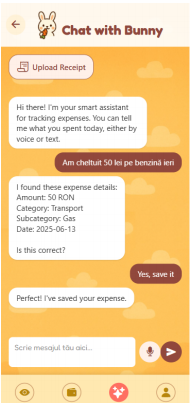
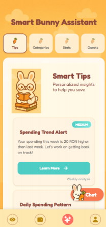
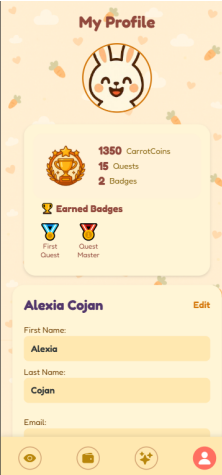
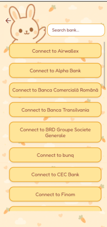

# 🐰 BunnyBuddy – Smart Finance Assistant

**BunnyBuddy** is a personal finance and budgeting application I built to make managing money feel less like a chore and more like a rewarding daily habit.

I wanted to create something that would make it easy to track everyday expenses, understand spending patterns and build better financial habits without relying on tedious manual entry. Instead of another traditional budgeting tool, I designed a friendly experience around a bunny-themed world, complete with custom illustrations, playful interactions and gamification.

The application combines **personal budgeting, bilingual natural language processing, voice input, receipt scanning, personalized financial insights and gamification** into one cohesive experience.
Every part of BunnyBuddy, from the original visual identity and illustrations to the application logic and interactive features, was designed and developed by me.
---

## 🧭 Main Navigation – 4 Functional Tabs

BunnyBuddy is organized into four main sections, each designed around a different part of the personal finance experience.

---

### 📌 1. Budget — Your Burrow Plan

A flexible budgeting system that helps users plan and manage their income and expenses.

- **Budget creation:**:
    - Guided setup process with customizable budget categories.
    - Weekly, biweekly and monthly budgeting periods.
    - Customizable start dates and spending limits.
    - Multiple income sources and expense categories.
    - Ability to edit budgets and adjust category allocations. 

- **Budget visualization**:
    - Category-based budget distribution charts.
    - Spending progress indicators.
    - Real-time remaining budget calculations.
    - Automatic updates as new expenses are recorded.

---

### 📌 2. Overview — Understanding Your Spending

Three different ways to explore and understand financial activity.

#### 📋 Carrot Trail — Expense List

- Chronological expense history.
- Monthly navigation.
- Expense details and editing.
- **Add Bunnyspense** button allows manual expense addition through an intuitive form.

#### 📊 Burrow Insights — Spending Charts

- Automatic expense grouping by category.
- Interactive spending visualizations.
- Category distribution and spending comparisons.

#### 📅 Daily Hop — Spending Calendar

- Monthly calendar with thematic icons for each day:
    - 🟢 Good Day – <33% of daily budget spent.
    - 🟡 Medium Day – between 33% and 75%.
    - 🔴 Bad Day – over 75% of daily budget spent.
- Daily expense summaries.
- An overview of spending patterns throughout the month.

---

### 📌 3.  AI — Bunny Assistant & Gamification

The core of BunnyBuddy is its intelligent assistance system, which combines custom-built natural language processing, spending analysis and personalized recommendations.

#### 💬 Bilingual Chat Assistant

- Add expenses by describing them naturally in Romanian or English.
- Custom-built NLP engine developed in TypeScript.
- Extracts amounts, dates, categories, subcategories and descriptions.
- Recognizes financial terminology, synonyms and natural date expressions.
- Supports Romanian text both with and without diacritics.
- Displays extracted information for review before saving.

Example inputs:
- "35 lei pentru cumpărături azi"
- "Spent 18 RON on coffee yesterday."

#### 🎙 Voice Assistant

- Voice-based expense entry in Romanian and English.
- Speech-to-text transcription followed by the same custom NLP parsing pipeline.
- Review and edit extracted expense details before saving.
- Support for browser and native speech input, depending on the platform.

#### 📷 OCR Receipt Scanner

- Receipt image processing through an Express backend and Asprise OCR.
- Automatic extraction of expense details, including amounts and dates.
- Post-processing and category suggestions.
- Review extracted information before adding an expense.

---

#### 📈 Personalized Financial Insights
- Spending comparisons between weeks and months.
- Identification of significant changes in spending patterns.
- Category-based analysis and recommendations.
- Context-aware financial tips based on recorded expenses.
- Suggestions for realistic savings targets.

#### 🎯 Quests & Challenges
- Daily, weekly and monthly financial challenges.
- Dynamically generated spending goals based on available spending history.
- Personalized challenges based on previous periods.
- Reward system with CarrotCoins, XP, levels and badges.
- Progress tracking and reward claiming.

The recommendation and quest systems use custom rule-based logic to analyze financial behavior and generate contextual feedback rather than relying on generic recommendations.

### 📌  4. Profile — Your Bunny Identity
A personalized space for tracking progress and managing account information.
- User profile and account management.
- Badge Wall displaying earned achievements.
- Gamification progress, levels and CarrotCoins.
- Bank selection and the initial GoCardless connection flow.

**Bank integration status:** The bank selection and connection flow has been started. Automatic transaction imports are not yet operational and require provider access and a transaction import callback.

## 🎮 Gamification & BunnyBuddy's Visual Identity
Gamification is integrated throughout the application rather than being treated as a separate feature.

The goal was to make financial management feel approachable, engaging and rewarding.

Key elements:
- 🥕 CarrotCoins: Virtual currency earned by completing quests.
- 🎯 Quests: Daily, weekly and monthly financial challenges.
- 🏆 Badges & Levels: Rewards for maintaining positive financial habits.
- 🐰 Bunny-themed interactions: Friendly messages, illustrations and playful terminology throughout the interface.

Custom terminology:

| Traditional Terminology | BunnyBuddy Terminology |
|-------------------------|------------------------|
| Add expense             | Add a Bunnyspense      |
| Expense history         | Carrot Trail           |
| Calendar                | Daily Hop              |
| AI Assistant            | Bunny Assistant        |
| Budget visualization    | Burrow Insights        |
| Budget                  | Burrow Plan            |
The entire visual identity was created specifically for BunnyBuddy, including the original bunny characters, illustrations, icons, visual elements and interface components.

## 🧠 Intelligent Systems & Implementation
One of the main challenges of BunnyBuddy was making expense entry intuitive while keeping the extracted financial information structured and reliable.
### Natural Language Processing (NLP)

I developed a custom bilingual NLP engine in TypeScript without relying on external NLP libraries.

It includes:
- A custom Romanian-English financial vocabulary and dictionary.
- Synonym recognition and semantic category mapping.
- Amount and currency extraction.
- Natural date recognition and normalization.
- Category and subcategory classification.
- Optional description extraction.
- Support for Romanian text with and without diacritics.

The parser was designed around realistic everyday financial messages rather than rigid predefined commands.

### Voice Processing Pipeline

Voice input uses the same NLP engine as text-based expense entry.

#### Voice → Speech transcription → Text parsing → Structured expense → User review → Saving

This allows both input methods to share the same extraction and validation logic.

### Receipt Processing Pipeline

Receipt images are sent to an Express backend, which communicates with the Asprise OCR service and returns extracted information for review.

The application then processes the returned data and helps the user classify and save the expense.

### Financial Insights & Recommendation Engine

BunnyBuddy analyzes historical spending data to identify changes and generate contextual suggestions.

For example, it can:
- Compare flexible spending between consecutive months.
- Identify increases in particular expense categories.
- Calculate potential savings from reducing spending.
- Generate challenges using historical spending patterns.
- Adapt initial quests to users who do not yet have enough financial history.
- The recommendation system uses custom rules and spending comparisons to provide explainable, context-dependent feedback.
## 🛠️ Architecture & Technologies

| Area | Technologies |
| :--- | :--- |
| **Frontend** | React Native, Expo, TypeScript |
| **Navigation** | Expo Router |
| **Backend** | Express.js |
| **Authentication** | Firebase Authentication |
| **Database** | Cloud Firestore |
| **State Management** | Context API, AsyncStorage |
| **NLP** | Custom TypeScript parsing engine |
| **OCR** | Asprise OCR API |
| **Voice** | Speech recognition APIs and Expo speech modules |
| **Data Visualization** | Interactive charts and calendar components |
| **Testing** | TypeScript, automated unit and integration tests |
| **Build** | Expo, npm |

### Project Structure

The application is organized into dedicated modules for its main features, including:
- auth — Authentication and account management.
- ai — NLP, voice processing, receipt recognition and financial insights.
- bank-connect — Bank selection and GoCardless connection flow.
- tabs — Main application navigation.
- screens — Application screens.
- components — Reusable UI components.
- utils — Helpers, types, translations and classification logic.

## 🧪 Testing & Quality Assurance

After refactoring and reviewing the application, I expanded its automated testing coverage to verify both individual components and complete user workflows.

#### Latest verification results:
- 187 automated tests passed
- 12 test suites passed
- TypeScript type checking passed.
- Web, Android and iOS production exports completed successfully.

### What I Tested

| Test area | Coverage |
| :--- | :--- |
| **Romanian & English NLP** | 32 examples covering amounts, dates, categories and subcategories, including Romanian text without diacritics. |
| **Voice & Chat** | 14 sample transcripts, language selection, editing, microphone errors and recording behavior. |
| **First-session workflow** | Complete onboarding, authentication, budget setup, expense entry, editing, voice, OCR, charts, calendar and quest rewards. |
| **Budget calculations** | Weekly, biweekly and monthly calculations, including Bucharest and Los Angeles time zones. |

### Example: End-to-End Application Workflow

I tested a complete user journey using a sample account and a 1,000 RON budget.

After recording and editing five expenses, the application correctly displayed:

* **120 RON** spent.
* **880 RON** remaining.
* **95 RON** under Food & Drinks.
* **25 RON** under Transport.

The spending was reflected in the chart and calendar, and completing a daily quest awarded 50 CarrotCoins and unlocked the First Hop badge.

### Example: Spending Analysis

Using sample monthly data, I tested the recommendation engine with flexible spending increasing from 250 RON to 300 RON.

BunnyBuddy identified the 20% increase and calculated that reducing flexible spending by 10% would free up 30 RON.

These examples use test data and demonstrate the expected application behavior rather than measured savings from real users.

**Testing limitations:** Voice tests use simulated transcriptions. Real-world microphone accuracy, receipt recognition across different devices and live bank integrations require additional testing with real devices and external services.

---

## 🚀 Running the Application Locally

### Prerequisites

* Node.js and npm.
* A Firebase project.
* Firebase Authentication enabled with Email/Password sign-in.
* A Firestore database configured with appropriate security rules.

### Installation

Clone the repository and install dependencies:

```bash
git clone https://github.com
cd licenta-budget-app
npm ci --ignore-scripts
```

Create your local environment file:

```bash
Copy-Item .env.example .env.local
```

Configure the Firebase web application settings in `.env.local`.

Use a separate Firebase project for development and test accounts. Never commit private credentials or API keys to the repository.

### Start the Application

```bash
npm run web -- --localhost
```

Open: [http://localhost:8081](http://localhost:8081)

To test the mobile layout, use the device toolbar in your browser's developer tools.

### Start the Backend

For receipt processing and the bank catalogue, start the Express server in a separate terminal:

```bash
cd server
npm install
npm run server
```

Configure the server environment variables using `server/.env.example` if the corresponding variables are needed:
* `ASPRISE_API_KEY`
* `GOCARDLESS_SECRET_ID`
* `GOCARDLESS_SECRET_KEY`

Speech recognition on mobile requires a compatible native development build.

### Run Tests & Type Checking

```bash
npm run typecheck
npm run test:ci
```

### Production Export

```bash
npx expo export --platform all
```

---

## 📸 Application Screenshots & Demos

🎞️ [Budget creation](https://drive.google.com/drive/folders/1zD9nYU2fS9u6U8J6LleyPth1kbmpWRdg?dmr=1&ec=wgc-drive-hero-goto)
🎞️ [chatbox](https://drive.google.com/drive/folders/1zD9nYU2fS9u6U8J6LleyPth1kbmpWRdg?dmr=1&ec=wgc-drive-hero-goto)
🎞️ [OCR](https://drive.google.com/drive/folders/1zD9nYU2fS9u6U8J6LleyPth1kbmpWRdg?dmr=1&ec=wgc-drive-hero-goto)
🎞️ [Add Bunnyspense + Card](https://drive.google.com/drive/folders/1zD9nYU2fS9u6U8J6LleyPth1kbmpWRdg?dmr=1&ec=wgc-drive-hero-goto)
🎞️ [Ai pages + badges](https://drive.google.com/drive/folders/1zD9nYU2fS9u6U8J6LleyPth1kbmpWRdg?dmr=1&ec=wgc-drive-hero-goto)


BunnyBuddy includes several custom-designed screens and interactive workflows. The following sections showcase the visual identity and main features of the application.

<table>
  <tr>
    <td></td>
    <td></td>
    <td></td>
  </tr>
  <tr>
    <td></td>
    <td></td>
    <td></td>
  </tr>
  <tr>
    <td></td>
    <td></td>
    <td></td>
  </tr>
</table>

## 👩‍💻 About the Developer

**Cojan Alexia Ilaria**

BunnyBuddy was independently designed and developed as a personal project, combining my interests in software development, product design, artificial intelligence and creative problem-solving.

From the original concept and visual identity to the frontend, backend integration, NLP engine, financial logic and testing, I worked across the entire development process.

I wanted to build more than a budgeting application: I wanted to create a product that makes an everyday task feel a little more enjoyable.

Every carrot counts! 🥕 🐰


